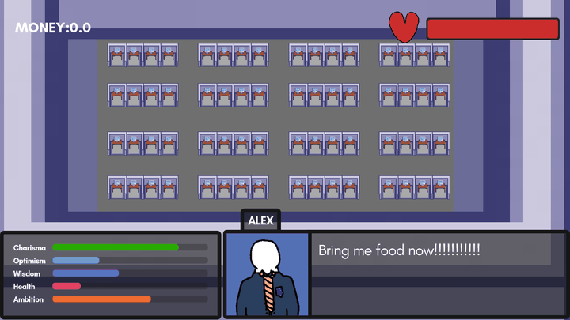

# Daydream 2025

An early Godot office-management game prototype. Add characters to a pixel-art office, keep an eye on their stats, and watch the in-game money counter grow.

## The prototype

The current scene combines a zoomable office floor with rows of cubicles and a character status panel. Characters have five tracked attributes: Charisma, Optimism, Wisdom, Health, and Ambition. The interface also shows character dialogue, a health bar, and accumulated money.

This is a work in progress. The current build focuses on the office scene and its HUD; several management interactions are still being explored.

## Controls

| Input | Action |
| --- | --- |
| Down Arrow | Add a character at the cursor |
| Middle mouse drag | Pan around the office |
| Mouse wheel | Zoom in or out |

## Run in Godot

1. Clone this repository.
2. Open `project.godot` in Godot 4.5 or newer.
3. Run the main scene.

The project uses GDScript and Godot's Compatibility renderer.
